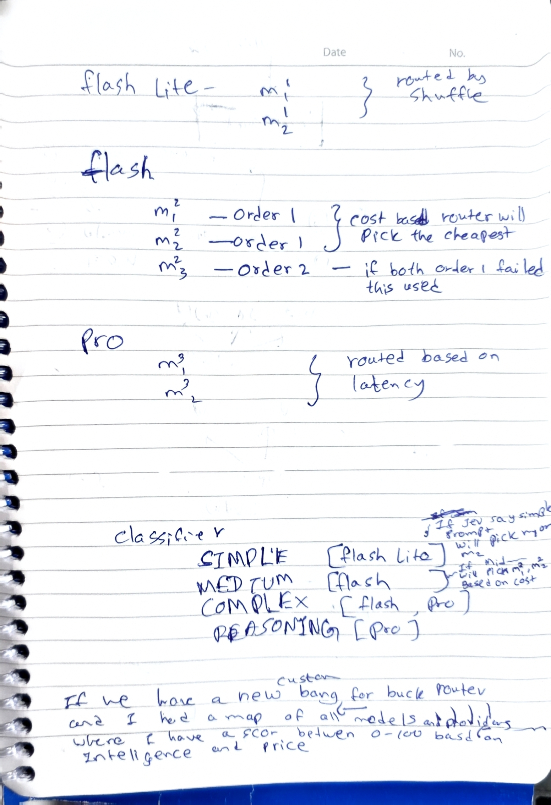

# LiteLLM Learnings

> Comprehensive reference covering architecture, deployment, configuration, routing, and production use. For beginners and quick reference.

---

## Table of Contents

1. [What is LiteLLM?](#1-what-is-litellm)
2. [Architecture & Components](#2-architecture--components)
3. [Operating Modes](#3-operating-modes)
4. [config.yaml Deep Dive](#4-configyaml-deep-dive)
5. [Docker Deployment](#5-docker-deployment)
6. [Model Configuration](#6-model-configuration)
7. [Pricing & Cost Tracking](#7-pricing--cost-tracking)
8. [Routing & Load Balancing](#8-routing--load-balancing)
9. [Virtual Keys, Teams & Users](#9-virtual-keys-teams--users)
10. [Admin UI](#10-admin-ui)
11. [Production Considerations](#11-production-considerations)
12. [Common Pitfalls & Bugs](#12-common-pitfalls--bugs)
13. [Quick Reference](#13-quick-reference)

---

## 1. What is LiteLLM?

LiteLLM is an **AI Gateway/Proxy** that sits between your applications and AI providers (OpenAI, Anthropic, Azure, Gemini, local models, etc.).

### Why Use It?

| Benefit | Description |
|---------|-------------|
| **Unified API** | One OpenAI-compatible format for all providers |
| **Cost Tracking** | Track spend per key, user, team |
| **API Key Security** | Developers use virtual keys; real provider keys stay hidden |
| **Load Balancing** | Route across multiple deployments/providers |
| **Rate Limiting** | Per-key, per-user, per-team limits |
| **Fallbacks** | Automatic failover when providers fail |

### How It Works

```
                           +---> OpenAI (Real key hidden)
                           |
[Your App] ---> [LiteLLM] -+---> Anthropic (Real key hidden)
 (Virtual        (Proxy)   |
  Key)                     +---> Azure OpenAI (Real key hidden)
                           |
                           +---> Local Model (Ollama, vLLM, etc.)
```

Your apps talk to LiteLLM using the standard OpenAI API format. LiteLLM translates and routes to the correct provider.

---

## 2. Architecture & Components

| Component | Purpose | Required? |
|-----------|---------|-----------|
| **LiteLLM Proxy** | The gateway process (stateless, can run multiple replicas) | Yes |
| **PostgreSQL** | Stores keys, teams, users, spend logs, config | Yes (for auth/tracking) |
| **Redis** | Rate limiting, router state, caching across instances | Only for 2+ instances |
| **config.yaml** | Bootstrap configuration file | Optional (when using DB) |
| **Admin UI** | Web interface at `/ui` for managing models, keys, spend | Requires database |

### Key Environment Variables

| Variable | Purpose |
|----------|---------|
| `LITELLM_MASTER_KEY` | Admin credential for the proxy. Required. |
| `LITELLM_SALT_KEY` | Encrypts provider credentials in DB. **Set once, never change.** |
| `DATABASE_URL` | PostgreSQL connection string |
| `STORE_MODEL_IN_DB` | When `"True"`, enables Admin UI model management + hybrid config |
| `DISABLE_SCHEMA_UPDATE` | Set `"true"` on proxy pods; migrations job handles schema |

---

## 3. Operating Modes

### Mode A: Quickstart (Database + Admin UI, No config.yaml)

- Docker Compose spins up LiteLLM + PostgreSQL
- All configuration done via Admin UI at `http://localhost:4000/ui`
- Models, virtual keys, budgets stored in database
- **No config.yaml needed**
- Full feature set: virtual keys, budgets, spend tracking, Admin UI

**When to use:** Team/company deployments with visual UI and full features.

### Mode B: Stateless (config.yaml Only, No Database)

- Single Docker container with mounted config.yaml
- No database, no Admin UI, no virtual keys, no spend tracking
- All configuration from YAML file
- **Budgets NOT enforced** (requires database)
- **Virtual keys do NOT work** (require database)

**When to use:** Simple personal use, local development, OpenAI-compatible API wrapper.

```bash
docker run \
    -v $(pwd)/config.yaml:/app/config.yaml \
    -e OPENAI_API_KEY=sk-... \
    -e LITELLM_MASTER_KEY=sk-... \
    -p 4000:4000 \
    docker.litellm.ai/berriai/litellm:latest \
    --config /app/config.yaml
```

### Mode C: Hybrid (Database + config.yaml)

- Both database AND config.yaml
- `STORE_MODEL_IN_DB=True` enabled
- config.yaml acts as **bootstrap**; database values override YAML on conflict
- Models from both sources load-balanced together (not merged/overridden)

**When to use:** YAML-based baseline config + Admin UI for dynamic changes.

### config.yaml vs Database Overlay (Hybrid Mode)

When `STORE_MODEL_IN_DB=True`:

| Setting | If changed in config.yaml | If changed in Admin UI |
|---------|--------------------------|------------------------|
| `model_list` | Reloaded on restart/reload | Additive - UI models load-balanced with YAML |
| `router_settings` | Applied on restart | **DB wins** - UI overrides YAML |
| `litellm_settings` | Applied on restart | **DB wins** - UI overrides YAML |
| `general_settings` | Applied on restart | **DB wins** - UI overrides YAML |

**Key rule:** Once you change a setting in Admin UI, editing the same setting in config.yaml and reloading will **not** override it. The DB value wins.

---

## 4. config.yaml Deep Dive

### Structure

```yaml
model_list:              # AI model definitions
litellm_settings:        # Module settings (temperature, caching, etc.)
router_settings:         # Routing/load-balancing settings
general_settings:        # Server settings (master_key, store_model_in_db)
environment_variables:   # Environment variables (REDIS_HOST, etc.)
```

### model_list

Defines which AI models are available:

```yaml
model_list:
  - model_name: gpt-4o              # Name your apps use
    litellm_params:
      model: openai/gpt-4o          # Provider/model format
      api_key: os.environ/OPENAI_API_KEY
  - model_name: gpt-4o-fallback     # Another deployment for load balancing
    litellm_params:
      model: azure/gpt-4o
      api_key: os.environ/AZURE_API_KEY
      api_base: https://my-azure.openai.azure.com/
```

**Key rules:**
- `model_name` = what your apps request (e.g., `model: "gpt-4o"` in API calls)
- Multiple entries with same `model_name` are load-balanced automatically
- Use `os.environ/<VAR_NAME>` to reference environment variables

### litellm_settings

```yaml
litellm_settings:
  drop_params: true          # Auto-drop unsupported params instead of erroring
  set_verbose: false         # Debug logging
  cache: true                # Enable response caching
  cache_params:
    type: redis
    host: "localhost"
    port: 6379
  max_budget: 100            # Global budget (ONLY works with database)
  budget_duration: "1mo"     # Budget reset period
```

### router_settings

```yaml
router_settings:
  routing_strategy: simple-shuffle    # or "least-busy", "latency-based-routing", etc.
  num_retries: 3                      # Auto-retry on failure
  timeout: 30                         # Request timeout in seconds
  allowed_fails: 5                    # Cooldown after this many failures
  cooldown_time: 60                   # Seconds to cooldown a failing deployment
```

### general_settings

```yaml
general_settings:
  master_key: sk-my-special-key     # Alternative to LITELLM_MASTER_KEY env var
  store_model_in_db: true           # Enable hybrid mode
  database_url: postgresql://...    # Alternative to DATABASE_URL env var
```

### environment_variables

```yaml
environment_variables:
  REDIS_HOST: localhost
  REDIS_PORT: 6379
  REDIS_PASSWORD: ""
```

---

## 5. Docker Deployment

### Docker Volumes with config.yaml

The `-v` flag (or `volumes:` in compose) bridges your host file to the container:

```
Your Host Machine                    Docker Container
+---------------------+              +---------------------+
| /path/to/config.yaml| ===========> | /app/config.yaml    |
+---------------------+              +---------------------+
```

### CLI Arguments with Docker

Arguments after the image name are passed to the entrypoint:

```bash
docker run <image> --config /app/config.yaml
# Behind the scenes runs: litellm --config /app/config.yaml
```

### Docker Compose Example (Hybrid Mode)

```yaml
services:
  litellm:
    image: ghcr.io/berriai/litellm:main-stable
    ports:
      - "4000:4000"
    volumes:
      - ./config.yaml:/app/config.yaml
    environment:
      - DATABASE_URL=postgresql://litellm:litellm@db:5432/litellm
      - STORE_MODEL_IN_DB=True
      - LITELLM_MASTER_KEY=${LITELLM_MASTER_KEY}
      - LITELLM_SALT_KEY=${LITELLM_SALT_KEY}
    depends_on:
      db:
        condition: service_healthy
    command: ["--config", "/app/config.yaml"]

  db:
    image: postgres:16
    environment:
      POSTGRES_USER: litellm
      POSTGRES_PASSWORD: litellm
      POSTGRES_DB: litellm
    healthcheck:
      test: ["CMD-SHELL", "pg_isready -U litellm"]
      interval: 5s
      timeout: 5s
      retries: 10
    volumes:
      - postgres_data:/var/lib/postgresql/data

volumes:
  postgres_data:
```

### Health Check Endpoints

| Endpoint | Purpose |
|----------|---------|
| `/health/liveliness` | Is the process alive? (liveness probe) |
| `/health/readiness` | Can it reach the database? (readiness probe) |

### Config Reload

**There is no `/config/reload` endpoint.** To reload config.yaml, restart the container:

```bash
podman compose -f docker-compose.yml restart litellm
```

---

## 6. Model Configuration

### Provider Format

| Provider | Format |
|----------|--------|
| OpenAI | `openai/<model>` |
| Azure OpenAI | `azure/<model>` |
| Anthropic | `anthropic/<model>` |
| Gemini | `gemini/<model>` |
| Bedrock | `bedrock/<model>` |
| Ollama | `ollama/<model>` |
| vLLM | `openai/<model>` with `api_base` set |
| Custom OpenAI-compatible | `openai/<provider-model>` with `api_base` set |

### OpenAI-Compatible Custom Providers

For custom OpenAI-compatible endpoints (like CommandCode, vLLM, etc.):

```yaml
model_list:
  - model_name: my-custom-model
    litellm_params:
      model: openai/deepseek/deepseek-v4.1-flash  # openai/ prefix + provider model name
      api_base: https://api.commandcode.ai/provider/v1
      api_key: os.environ/CUSTOM_API_KEY
```

- `openai/` prefix tells LiteLLM to use OpenAI-compatible protocol
- Everything after `openai/` is sent as the model name to the provider
- `api_base` overrides the default OpenAI endpoint

### model_name is Just an Alias

`model_name` is the name your apps request. It is **NOT** access control or tiering.

```yaml
model_list:
  - model_name: pro-tier    # Apps request this
    litellm_params:
      model: openai/deepseek/deepseek-v4-pro
  - model_name: pro-tier    # Same name = load-balanced together
    litellm_params:
      model: openai/qwen/qwen3.7-plus
```

When an app requests `model: "pro-tier"`, LiteLLM load-balances between DeepSeek V4 Pro and Qwen 3.7 Plus.

### Token Limits & `model_info`

Every deployment can carry token limits in `model_info`. They are what clients
read from `/v1/model/info` to size their requests.

| Field | Meaning |
|-------|---------|
| `max_input_tokens` | Largest **input** (prompt) the model accepts |
| `max_output_tokens` | Largest **output** (completion) the model can produce |
| `max_tokens` | Completion cap LiteLLM reports (cost-map convention: the output limit) |

**Discovery fills the gaps — wrongly for output.** For OpenAI-compatible
deployments LiteLLM refreshes model info from the provider's `/models` response
(`context_length`). When no output limit is published, discovery mirrors the
**context window** into `max_output_tokens` (verified in
`litellm/llms/openai_like/model_info.py`). The gateway then advertises, say,
1,050,000 output tokens for a model that can produce 128,000.

**Precedence:** values you configure in `model_info` win over discovered ones —
so stating the limits explicitly is the reliable fix.

```yaml
model_list:
  - model_name: pro-tier
    litellm_params:
      model: openai/gpt-6.1-sol
      api_base: https://api.commandcode.ai/provider/v1
    model_info:
      max_input_tokens: 922000      # context 1,050,000 - output 128,000
      max_output_tokens: 128000
      max_tokens: 128000
```

**Updating them:** the legacy `POST /model/update` writes `litellm_params` but
**ignores `model_info`** (its own docstring points at the PATCH route).
`PATCH /model/{model_id}/update` merges `model_info` per key and keeps fields it
does not receive. `{model_id}` is the stored `model_info.id`, and it travels in
the URL **path** — so ids must stay URL-safe; a `/` is decoded before routing
and either splits the route or arrives as a literal `%2F`.

> Rule of thumb: `max_input_tokens = context - max_output_tokens`. The provider's
> context window is the authority for context; the output cap is the model's own
> capability (the models.dev catalog publishes it).

**Docs:** https://docs.litellm.ai/docs/proxy/model_management ·
Source: `litellm/proxy/management_endpoints/model_management_endpoints.py`
(`patch_model`, `update_db_model`), `litellm/llms/openai_like/model_info.py`,
and the models.dev catalog (https://models.dev/api.json) for output caps.

### Multimodal & Capability Metadata

`model_info` is also where LiteLLM advertises what a model accepts. Clients that
read `/model/info` (the Admin UI, OpenCode's model-discovery plugin, custom
proxies) use these fields to decide whether to offer images, PDFs, audio, video,
tools, or structured output.

| Field | Meaning |
|-------|---------|
| `supports_vision` | Accepts image input |
| `supports_pdf_input` | Accepts PDF input |
| `supports_audio_input` | Accepts audio input |
| `supports_video_input` | Accepts video input |
| `supports_audio_output` | Produces audio output |
| `supports_function_calling` | Accepts tool/function definitions |
| `supports_response_schema` | Accepts a structured-output schema |
| `modalities.input` / `modalities.output` | Exact input/output modality list (`text`, `image`, `pdf`, `audio`, `video`) |
| `mode` | `chat` for chat models; clients use it to filter non-chat deployments |

```yaml
model_list:
  - model_name: pro-tier
    litellm_params:
      model: openai/deepseek/deepseek-v4.1-flash
      api_base: https://api.commandcode.ai/provider/v1
      api_key: os.environ/COMMANDCODE_API_KEY
    model_info:
      mode: chat
      supports_vision: true
      supports_pdf_input: true
      supports_audio_input: false
      supports_video_input: false
      supports_function_calling: true
      supports_response_schema: true
      modalities:
        input: [text, image, pdf]
        output: [text]
```

**The flag is advertisement, not a gate.** On LiteLLM 1.108 an
`openai/...` deployment forwards `image_url` content even when
`supports_vision` is absent. The flag matters because clients use it to decide
whether to attach the image at all. If a client shows a text-only model, check
`/model/info` first.

`modalities` is the exact declaration; the individual flags are convenience.
Models that do not publish a specific media type should not claim it — an
unresolved capability is better than a false one. `attachment: true` in
models.dev is too broad to mean "image"; do not infer media support from it.

**Admin UI:** Models + Endpoints → **Add Model** → **Advanced Settings** →
**Model Info** (JSON). For an existing model: click the model ID → **Edit
Settings** → **Model Info** → **Save Changes**. The form has no dedicated
vision/PDF/audio dropdowns; this JSON field is the control.

**Docs:** https://docs.litellm.ai/docs/completion/vision ·
Source: `litellm/types/utils.py` (`ProviderSpecificModelInfo`),
`litellm/utils.py` (`get_model_info` / `supports_*` flags).

### Reasoning Metadata & Effort

LiteLLM advertises reasoning support through `model_info` and reads it back from
`/model/info` and `/model_group/info`.

| Field | Meaning |
|-------|---------|
| `supports_reasoning` | The model can reason / produce thinking output |
| `reasoning_effort_levels` | The exact `reasoning_effort` values the model accepts (for example `[low, high, max]`) |
| `supports_none_reasoning_effort` | Accepts `none` |
| `supports_minimal_reasoning_effort` | Accepts `minimal` |
| `supports_low_reasoning_effort` | Accepts `low` |
| `supports_xhigh_reasoning_effort` | Accepts `xhigh` |
| `supports_max_reasoning_effort` | Accepts `max` |

`GET /model_group/info` exposes the resolved list as
`supported_reasoning_efforts`, intersected across the deployments in the group.
LiteLLM treats `medium` and `high` as unconditional in its own resolver, so the
level list is the authoritative declaration; the per-level flags refine it.

**What actually happens to `reasoning_effort`:**

- `openai/...` deployments: the string is passed through to the upstream. The
  upstream decides what it means.
- `anthropic/...` deployments: LiteLLM maps the effort to
  `thinking: {type: enabled, budget_tokens: N}`. The built-in defaults are
  `minimal=128`, `low=1024`, `medium=2048`, `high=4096`, `xhigh=8192`,
  `max=16384`; the `DEFAULT_REASONING_EFFORT_*_THINKING_BUDGET` environment
  variables override them globally.
- **Important:** an `anthropic/...` deployment without
  `supports_reasoning: true` silently drops `reasoning_effort` (verified on
  1.108; `drop_params: true` hides it). The upstream never sees a thinking
  budget. This is the usual reason "effort does nothing" on Claude-style
  deployments.

```yaml
model_info:
  supports_reasoning: true
  reasoning_effort_levels: [low, high, max]
  supports_none_reasoning_effort: false
  supports_minimal_reasoning_effort: false
  supports_low_reasoning_effort: true
  supports_medium_reasoning_effort: false
  supports_high_reasoning_effort: true
  supports_xhigh_reasoning_effort: false
  supports_max_reasoning_effort: true
```

`supports_medium_reasoning_effort` and `supports_high_reasoning_effort` are not
LiteLLM fields; they pass through `model_info` and are read by some clients
(the OpenCode model-discovery plugin is one). LiteLLM's own five flags plus
`reasoning_effort_levels` are the standard part.

**When no effort levels are published:** set `supports_reasoning: true`,
emit an empty `reasoning_effort_levels` list, and omit the per-level flags.
LiteLLM then reports no known levels (`supported_reasoning_efforts: []`); clients
with their own default (the OpenCode plugin defaults to `low/medium/high`) may
still offer variants. Do not invent levels the provider did not publish.

**Rounding:** LiteLLM rounds an unsupported effort request **up** to the nearest
offered level by default (`model_info.reasoning_effort_rounding: "up"`). Asking
for `medium` on a `low/high/max` model therefore gets `high`. The value is not
set by this project's pipeline; it is LiteLLM's default behavior.

**Admin UI:** same **Model Info** JSON field as the multimodal fields.

**Docs:** https://docs.litellm.ai/docs/reasoning_content ·
https://docs.litellm.ai/docs/providers/anthropic_effort ·
Source: `litellm/router_utils/reasoning_effort_capability.py`,
`litellm/types/utils.py`, `litellm/llms/anthropic/chat/transformation.py`
(`_map_reasoning_effort`).

---

## 7. Pricing & Cost Tracking

### LiteLLM's Built-in Cost Map

LiteLLM prices every request from a **cost map** — a JSON file mapping each model to per-token rates:
- **File:** `model_prices_and_context_window.json`
- **Source:** https://github.com/BerriAI/litellm/blob/main/model_prices_and_context_window.json

The proxy fetches it once at startup. `GET /model/cost_map/source` reports which map actually loaded.

### Display vs Accounting Cost (Important)

There are **two separate cost paths** that can disagree:

| Path | What it uses | Where you see it |
|------|--------------|------------------|
| **Display** | `model_info` / `base_model` resolution | Admin UI "Models + Endpoints" page |
| **Accounting** | cost-map lookup (candidate chain below) | Spend logs, budgets |

**A price visible in the UI does not guarantee request cost is calculated.** Always confirm with a spend log.

### Using base_model for Automatic Pricing

`base_model` tells LiteLLM which cost-map entry to use when the deployment name or the provider's response name differs:

```yaml
model_list:
  - model_name: my-deployment
    litellm_params:
      model: openai/deepseek/deepseek-v4.1-flash
    model_info:
      base_model: openrouter/deepseek/deepseek-v4.1-flash  # Maps to cost map entry
```

### How Cost Calculation Actually Works

The cost lookup is a **candidate chain** — LiteLLM tries names in order and uses the **first that resolves to a non-empty cost-map entry**:

```
1. selected_model   (derived from base_model / custom pricing)
2. response model   (the model name the provider returns)
3. model            (the deployment's litellm_params.model)
```

Two consequences that are easy to miss:

- **Empty entries are skipped.** An entry that exists but has no pricing (`{}`) is silently passed over.
- **Every candidate is looked up through the deployment's provider prefix.** `base_model`'s own provider prefix is *not* honored (LiteLLM bug #22257). So a `base_model` with a different provider than the deployment (deployment `openai/...`, base_model `openrouter/...`) gets re-prefixed to `openai/...` and can miss.

**Practical rule:** the most reliable way to price a custom deployment is to add a cost-map entry keyed by **exactly `litellm_params.model`**. Then candidate 3 always resolves and `base_model` becomes unnecessary.

### Custom Pricing (per model, in config)

If the model is NOT in the cost map, set explicit per-token prices:

```yaml
model_list:
  - model_name: my-model
    litellm_params:
      model: openai/custom-model
    model_info:
      input_cost_per_token: 0.00000015          # $0.15 per million input tokens
      output_cost_per_token: 0.0000006          # $0.60 per million output tokens
      cache_read_input_token_cost: 0.000000003  # $0.003 per million cache read tokens
```

**Calculation:** `$X per million tokens` = `X / 1,000,000` per token

### Custom Cost Map Source (self-hosted)

Host your own **full copy** of the map and point LiteLLM at it:

```bash
# Environment variable
LITELLM_MODEL_COST_MAP_URL="https://your-host.example.com/custom_cost_map.json"
```

| Rule | Detail |
|------|--------|
| **Full replacement, not a merge** | Start from the complete upstream file and edit inside it |
| **Validation (silent)** | Needs ≥ **50** entries *and* ≥ **half** the bundled backup, or it is **discarded** |
| **Tunable thresholds** | `MODEL_COST_MAP_MIN_MODEL_COUNT`, `MODEL_COST_MAP_MAX_SHRINK_RATIO` |
| **Fetch** | Once at startup, 5s timeout; changes require a restart |
| **On failure** | Falls back to the bundled backup **silently** (no crash) |
| **URL** | HTTP(S) only; `file://` not supported |
| **Offline alternative** | `LITELLM_LOCAL_MODEL_COST_MAP=True` uses the bundled backup |

**Keys must match `litellm_params.model` exactly**, provider prefix included.

> ⚠️ A small map containing only your models is **silently rejected** — LiteLLM keeps the default map. This is the most common reason a custom map "doesn't work."

**Docs:** https://docs.litellm.ai/docs/proxy/custom_model_cost_map · https://docs.litellm.ai/docs/proxy/custom_pricing


---

## 8. Routing & Load Balancing

### Routing Strategies

| Strategy | Picks | Best for |
|----------|-------|----------|
| `simple-shuffle` (default) | Weighted by `rpm`/`tpm`, else random | Production (recommended) |
| `least-busy` | Fewest active requests | High concurrency |
| `latency-based-routing` | Fastest responding | Latency-critical |
| `cost-based-routing` | Cheapest deployment | Cost-sensitive |
| `usage-based-routing` | Lowest TPM usage | Even rate-limit spread (needs Redis, slow) |



### How They Compose (Layered)

```
Request for "flash-tier"
        │
   1. Resolve model group      → all deployments with model_name: flash-tier
        │
   2. Filter by `order`        → keep only the MIN order among healthy
        │                        deployments (lower = higher priority)
        │
   3. Routing strategy         → pick ONE candidate from that tier
        │                        (simple-shuffle = random; cost-based is
        │                         deterministic → always the cheapest)
        │
   4. Failure                  → retries re-run step 3 (num_retries times).
        │                        If the failed deployment is still healthy,
        │                        a deterministic strategy can re-pick it.
        │                        With allowed_fails: 0 the first failure
        │                        benches it, so the next retry picks a
        │                        sibling at the same order.
        │
   5. Escalation               → when no healthy deployment remains at the
        │                        current order, move to the next `order` tier
        │                        (only if ≥2 distinct order values). With a
        │                        high allowed_fails, retries may exhaust
        │                        before the siblings are benched, so they are
        │                        skipped.
        │
   6. Fallbacks                → if every tier fails, switch to a DIFFERENT
                                 group (only if `fallbacks` is configured);
                                 otherwise the original error is raised
```

> **Key gotcha:** the routing strategy only *selects* — it is not a failover
> chain. Same-tier failover comes from **cooldown + retry**: set
> `allowed_fails: 0` per deployment so the first failure removes it from the
> healthy pool, then `num_retries` re-runs selection and picks a sibling. With a
> low `allowed_fails` this works with `latency-based-routing`; `cost-based` will
> still re-pick the cheapest healthy key. `enable_weighted_failover` is a
> separate `simple-shuffle`-only option. See “Same-order latency pool failover”
> below and §12 pitfall 18.

### routing_groups (Per-Model Strategies)

Override the global strategy for specific model groups:

```yaml
router_settings:
  routing_strategy: simple-shuffle  # Global default
  routing_groups:
    - group_name: flash-cost-optimized
      models: [flash-tier]
      routing_strategy: cost-based-routing
    - group_name: pro-latency-optimized
      models: [pro-tier]
      routing_strategy: latency-based-routing
      routing_strategy_args:
        lowest_latency_buffer: 0.5  # Consider any deployment within 50% of fastest
```

### Routing Groups Are Also Callable "Virtual Models"

A `group_name` is not just a label — it is **its own requestable model**:

| Fact | Detail |
|------|--------|
| Callable | `model: "flash-cost-optimized"` → LiteLLM picks across the **union of all member deployments** using the group's strategy |
| Listed | Group names appear in `GET /v1/models` and in the Admin UI model pickers |
| Access control | Treated as **its own model name**. Grant `<group_name>` on a key/team to allow it. Membership is **not expanded**: a key granted only the group cannot call the member (`flash-tier`), and a key granted the member cannot call the group |
| Name collision | A `group_name` must not equal an existing `model_name`/`model_group_alias` (config load rejects it) |
| Membership | Each `model_name` may belong to **at most one** group (overlap raises `ValueError`) |
| Spend logs | Record the **group name** as `model_group` (the row also shows the serving deployment) |

> **When to use:** name a set of deployments that share a strategy, then grant that single name instead of listing every member. Remember access control treats the group and its members as *different* names.

**Docs:** https://docs.litellm.ai/docs/routing#routing-groups

### Deployment Ordering (Failover via `order`)

`order` is a **deployment property** in `model_list[*].litellm_params` (or `model_info`):

```yaml
model_list:
  - model_name: flash-tier
    litellm_params:
      model: openai/deepseek/deepseek-v4.1-flash
      order: 1        # Always tried first
  - model_name: flash-tier
    litellm_params:
      model: openai/deepseek/deepseek-v4-flash
      order: 2        # Used after the order-1 attempts fail
```

**How it works (verified against `litellm/router.py`):**
- Lower value = higher priority
- Order filtering runs **before** the routing strategy: only the **minimum order** among currently healthy deployments is eligible
- Deployments sharing the same `order` are picked by the routing strategy
- On failure at order N, after `num_retries` are exhausted, the router escalates to order N+1. Each tier gets its **own** retry budget
- The order hop only happens when the group has **≥2 distinct order values**. With no `order`, or a single level, there is no order-based failover
- `ContextWindowExceededError` / `ContentPolicyViolationError` skip order-based failover (they have dedicated fallbacks)

### Auto-router selections and tier order fallbacks

An auto-router such as `smart-router` first chooses a **model group** (for example, `pro-tier`); LiteLLM then chooses a deployment in that group. A direct call to `pro-tier` and a call through `smart-router` were not identical for automatic order failover in our 1.103.0 test: the router built its automatic order chain from the model name in the original request. For `smart-router`, that was the router entry, not the tier it selected, so the direct tier call advanced through order levels while the auto-router call did not.

LiteLLM 1.108's router source now resolves the order-fallback group with `get_pre_routing_selection(kwargs)`, which is exactly the auto-router (pre-routing hook) case. This likely fixes the 1.103 behavior. Retest on the running proxy before removing the `_target_order` entries below; they remain harmless while present.

To make tier-level order retries available on the auto-router path, configure fallback targets under the tier name. The following dict-entry form asks LiteLLM to retry the same tier, restricted to each later order level:

```yaml
router_settings:
  fallbacks:
    - pro-tier:
        - {model: pro-tier, _target_order: 2}
        - {model: pro-tier, _target_order: 3}
        - {model: pro-tier, _target_order: 4}
```

- The initial `pro-tier` request uses the tier's normal lowest-order selection and retry policy. If it still fails after retries, the configured entries try order 2, then 3, then 4, in sequence.
- This uses order numbers, not provider model names or deployment IDs. Add an entry for each order level you want as a fallback.
- Our `config.yaml` applies this pattern to `pro-tier`, `flash-tier`, `ultra-tier`, and `flash-lite-tier`, with fallback orders 2–5.
- **Status:** this dict form with `_target_order` is not shown in the official fallback docs. It was confirmed working in our VPS deployment running LiteLLM 1.103.0; treat it as a version-sensitive workaround, not a documented stable interface.
- Standard `fallbacks` between model groups are documented and are a separate feature: for example, `pro-tier` can fall back to `flash-tier`.
- Because `router_settings.fallbacks` is shared by direct tier calls and auto-router calls, a direct call may first exhaust its automatic order chain and then reach the configured order-2+ entries. If every deployment fails, this can retry order levels already attempted; watch retry counts and cost.

**Flow:**

```
Direct call:  pro-tier → order 1 fails → automatic order 2 → order 3 ...
Auto-router:  smart-router → selects pro-tier → order 1 fails
                                      └→ configured tier fallback → order 2 → order 3 ...
```

**What same-tier failover does NOT do by default:**

A routing strategy does not, by itself, guarantee that a failed deployment is
replaced by a sibling at the same `order`. With the default `allowed_fails: 5`,
the first few failures do not bench the key, so `num_retries` can re-pick it —
and `cost-based-routing` will deterministically re-pick the same cheapest one.
After retries are exhausted, the router escalates to the next order and skips
the untried sibling.

Set `allowed_fails: 0` (per deployment) to make the first failure bench the key;
then the next retry picks a healthy sibling at the same order. See the next
subsection.

### Same-order latency pool failover (recommended)

This is the “third option” between strict consecutive-order failover and a
latency strategy that never tries a sibling. Keep every key of the same model at
the **same `order`**, let latency routing pick the fastest healthy key, and make
the first failure bench that key so the retry picks the next sibling.

```yaml
model_list:
  - model_name: flash-tier
    litellm_params:
      model: openai/deepseek/deepseek-v4.1-flash
      api_base: https://api.commandcode.ai/provider/v1
      api_key: os.environ/COMMANDCODE_API_KEY_1
      order: 2
      num_retries: 4            # enough to walk the same-order keys
    model_info:
      allowed_fails: 0          # first failure benches this key
      cooldown_time: 300        # 5 minutes; see the walk-time formula below

  - model_name: flash-tier
    litellm_params:
      model: openai/deepseek/deepseek-v4.1-flash
      api_base: https://api.commandcode.ai/provider/v1
      api_key: os.environ/COMMANDCODE_API_KEY_2
      order: 2
      num_retries: 4
    model_info:
      allowed_fails: 0
      cooldown_time: 300

router_settings:
  routing_strategy: latency-based-routing
  routing_strategy_args:
    lowest_latency_buffer: 0    # 0 = strict lowest latency
  num_retries: 4
  retry_policy:
    DefaultRetries: 4           # covers 402 (APIError)
    RateLimitErrorRetries: 4
    InternalServerErrorRetries: 4
    AuthenticationErrorRetries: 4
    BadRequestErrorRetries: 1
    NotFoundErrorRetries: 0
```

**What happens:**

1. `order` filtering keeps the lowest order (2).
2. `latency-based-routing` picks the fastest healthy key at that order.
3. If it fails, the failure counter increments. With `allowed_fails: 0`, the
   key is benched for `cooldown_time`.
4. `num_retries` re-runs selection; the benched key is gone, so it picks another
   sibling at order 2.
5. If every order-2 key is benched, the router escalates to order 3 (the next
   model).
6. Later requests skip the benched key until its cooldown expires.

**Error behavior on LiteLLM 1.108 (verified with fake upstreams):**

| Upstream error | Same-request sibling retry? | Notes |
|---|---|---|
| `500` | Yes | Retryable; works once the failed key is benched |
| `429` | Yes | Retryable and immediately cooled down |
| `401` | Yes in our test | Set `AuthenticationErrorRetries` explicitly |
| `402` | Yes **with** a retry policy; no without | Without it, the first request fails, the key is benched, and later requests avoid it |
| `403` / `404` | Likely with a retry policy; no without | Verify for your provider |
| `400` | No | Caller error; don't bench or retry |

`402` is the “allowance ended” case. `DefaultRetries` is what makes the same
request move to the next key; without it, only the next request benefits.

**Sizing `num_retries` and `cooldown_time`:**

`num_retries` is the retry budget for the **current order**, after the initial
attempt. Each retry re-selects from the healthy pool. If it is lower than
`keys - 1`, some siblings are skipped before escalation. If it is higher, the
extra budget is unused once the pool is exhausted — provided the keys are
benched. With `allowed_fails: 1`, each key can fail twice, so double the walk.

```text
cooldown_time > max_keys_per_order × attempts_per_key × timeout
```

With `allowed_fails: 0` and `InternalServerErrorAllowedFails: 1`,
`attempts_per_key` is 2. A 30-minute cooldown with a 20-second per-attempt
timeout covers roughly 45 keys.

**A per-exception compromise:**

```json
{
  "allowed_fails": 0,
  "allowed_fails_policy": {
    "InternalServerErrorAllowedFails": 1,
    "RateLimitErrorAllowedFails": 0,
    "AuthenticationErrorAllowedFails": 0
  }
}
```

This gives a `500` one retry on the same key, but `402` / `429` / `401` bench
immediately. There is no per-error cooldown time; the same `cooldown_time`
applies to every benched key.

**Admin UI:** for each key, **Models + Endpoints → Add Model**, use the same
public model name, then **Advanced Settings → LiteLLM Params**:

```json
{"order": 2, "num_retries": 4}
```

and **Advanced Settings → Model Info**:

```json
{"allowed_fails": 0, "cooldown_time": 300}
```

For an existing deployment: click the model ID → **Edit Settings**, then edit the
same two JSON fields.

`enable_weighted_failover` is **not** needed for this path. It is a separate
`simple-shuffle`-only option (`litellm/router.py::_maybe_run_weighted_failover`
returns early for other strategies).

**Docs:** https://docs.litellm.ai/docs/routing#deployment-ordering-priority ·
https://docs.litellm.ai/docs/proxy/reliability ·
Source: `litellm/router.py` (`async_function_with_retries`,
`_maybe_run_weighted_failover`), `litellm/router_utils/cooldown_handlers.py`
(`allowed_fails`, `allowed_fails_policy`), `litellm/utils.py`
(`should_retry`, `get_order_filtered_deployments`).

### Example: cost-based-routing + order

```yaml
model_list:
  - model_name: flash-tier
    litellm_params:
      model: openai/deepseek/deepseek-v4.1-flash
      order: 1
  - model_name: flash-tier
    litellm_params:
      model: openrouter/qwen/qwen3.8-omni-flash
      order: 1
  - model_name: flash-tier
    litellm_params:
      model: openai/deepseek/deepseek-v4-flash
      order: 2

router_settings:
  num_retries: 3
  allowed_fails: 5
  cooldown_time: 60
  routing_groups:
    - group_name: flash-cost-optimized
      models: [flash-tier]
      routing_strategy: cost-based-routing
```

**Scenario 1: All endpoints working**
- Order 1: {V4.1, Qwen} → cost-based picks cheapest (V4.1 at $0.15/M)
- **V4.1 Flash responds**

**Scenario 2: V4.1 fails a request**
- Order 1: {V4.1, Qwen} → cost-based picks V4.1 (cheaper)
- V4.1 fails → retries re-run cost-based → **V4.1 again** (×num_retries)
- Retries exhausted → escalate to **Order 2: {V4 Flash}** → **V4 Flash responds**
- Qwen (order 1) is **not tried in this request** because `allowed_fails: 5`
  keeps V4.1 healthy through the retries. It gets traffic on later requests once
  V4.1 exceeds `allowed_fails`. If you set per-deployment `allowed_fails: 0`,
  V4.1 is benched on the first failure and Qwen is retried in the same request.

**Scenario 3: V4.1 keeps failing across requests**
- After V4.1 exceeds `allowed_fails` (5) failures in the window, it is cooled
  down for `cooldown_time` (60s) and excluded from picks
- Later requests: cost-based now picks **Qwen** (order 1)
- If both order-1 deployments are cooled down → escalate to order 2 (V4 Flash)

### Failover Options (how to get "try X, then Y, then Z")

| Goal | Config |
|------|--------|
| Strict priority chain (cheapest → … → backup) | unique `order` per deployment (`1`/`2`/`3`, ranked by cost). Each tier has one candidate, so the routing strategy no longer chooses |
| **Latency pick with same-order failover** (recommended) | `routing_strategy: latency-based-routing` + shared `order` + per-deployment `model_info.allowed_fails: 0` + `num_retries` + `retry_policy` for `402`. A failed key is benched and the retry picks a sibling |
| Weighted intra-group failover | `routing_strategy: simple-shuffle` + `enable_weighted_failover: true` (re-picks in the group, excluding the failed deployment) — **not** compatible with cost/latency strategies |
| Cost pick, failover only after cooldown | `cost-based-routing` + shared `order`. The failed key is re-picked until `allowed_fails` benches it |
| Escape to another group | `router_settings.fallbacks: [{"pro-tier": ["flash-tier"]}]` |

### Fallbacks (Different Model Groups)

Configured fallbacks can switch to another model group after the primary request fails. For example, route a failed `pro-tier` request to `flash-tier`:

```yaml
router_settings:
  fallbacks:
    - pro-tier: ["flash-tier"]
```

This is different from deployment `order`: `order` moves between deployments within one model group; this fallback moves to a different model group. The tier-keyed `_target_order` pattern above uses configured fallbacks to retry a selected tier at a specified order level.

**Docs:** https://docs.litellm.ai/docs/proxy/reliability · https://docs.litellm.ai/docs/proxy/load_balancing#deployment-ordering-priority

---

## 9. Virtual Keys, Teams & Users

The identity layer: who can call the proxy, what they can reach, how their spend is capped, and where it is attributed.

### Tenancy Hierarchy

```
Organization                       ← Enterprise only
  └── Team                         ← top boundary in open source
        budget + models + rate limits
        └── User (member)
              └── Key
```

- **Orgs ⊃ Teams ⊃ Users.** Both **Users and Teams own Keys.**
- Every request's spend is attributed to **key + user + team (+ org) at once**, and budgets are checked at every level on the path.
- **Orgs are Enterprise.** In OSS, **Teams are the top tenant boundary.**

| Relationship | How many |
|--------------|----------|
| Team → Users | many |
| User → Teams | many (a user can be in several teams) |
| User → Keys | many |
| Team → Keys | many |
| Key → `user_id` | at most one (or none) |
| Key → `team_id` | at most one (or none) |

### Three Kinds of Key

| Type | `user_id` | `team_id` | Limits applied | Use case |
|------|-----------|-----------|----------------|----------|
| **Personal** | the user | — | user + key | one individual |
| **Team-member** | the user | the team | user + team-member + team + key | engineer inside a team |
| **Service account** | **`null`** | **required** | **team only** | shared/production key; survives user deletion; immutable `service_account_id` |

- In the Admin UI, a service account is created from its **own page** (`Virtual Keys → Service Account`). The normal **Create Key** flow, used by an admin, stamps **`default_user_id`** as the owner — that is **not** a service account.
- Deleting a user deletes the keys **they personally own**; team service-account keys survive.

### Roles

| Role | Scope | Can |
|------|-------|-----|
| `proxy_admin` | platform | everything |
| `proxy_admin_viewer` | platform | view all keys/spend (no create/delete) |
| `internal_user` | platform | manage **own** keys, view own spend |
| `internal_user_viewer` | platform | view own keys/spend only |
| `org_admin` | one org | **Enterprise** |
| `team_admin` | one team | manage team members/keys; may **lower** (not raise) the team budget |

> **OSS limitation:** assigning a team member as `admin` is **Enterprise** — the UI rejects it with *"Assigning admins is an enterprise-only feature."* In OSS the **proxy admin is the admin of every team**.

### Model Access — How It Combines

**Rule: model access is an AND / narrowing operation.** A key must pass every applicable check.

| `models` value | Means |
|----------------|-------|
| `[]` (empty) or `["*"]` | **all** models on the proxy |
| `["flash-tier"]` | that model group only |
| `["openai/*"]` | wildcard, matched against `model_name` |
| `["my-group"]` | **access group** (`model_info.access_groups`) — expands at auth time |
| `["all-proxy-models"]` | explicit "everything" |
| `["all-team-models"]` | defer to the team's list |
| `["no-default-models"]` | (user only) deny everything outside a team |

| Key has `team_id`? | Effective access |
|--------------------|------------------|
| No (standalone) | the key's own `models` list (owner's list applies on top) |
| Yes | **`key.models ∩ team.models`** (the intersection) |

| Sentinel | Key | Team | User |
|----------|:--:|:----:|:----:|
| `all-proxy-models` | ✅ | ✅ | ✅ |
| `all-team-models` | ✅ only | ❌ | ❌ |
| `no-default-models` | ❌ | ❌ | ✅ only |

- Rejections name the layer that blocked: `key` / `team` / `user` / `org` `not allowed to access model…`.
- The **master key bypasses every model and budget check.**

### Budgets — How They Combine

**Rule: budgets are independent caps.** All applicable layers are checked, spend is attributed to all of them, and the **first one exhausted blocks**.

| Layer | Set on | Standalone key | Team-attached key |
|-------|--------|:--------------:|:-----------------:|
| Key | key `max_budget` | ✅ | ✅ (still enforced) |
| User (personal) | user `max_budget` | ✅ | ❌ **ignored** |
| Team | team `max_budget` | — | ✅ |
| Team-member | `max_budget_in_team` | — | ✅ |
| Global | `litellm_settings.max_budget` | ✅ | ✅ |
| Per-model | `model_max_budget` | 🔒 Enterprise | 🔒 Enterprise |

- If a key has a `team_id`, its owner's **personal budget is not enforced** — use the **team-member budget** for a per-person cap.
- Errors name the layer: `Budget has been exceeded! Key=… / TeamMember=… / Team=…` or `ExceededBudget: User=…`.
- Budgets require a database; without one the global budget **fails open**.

### Config-Driven Defaults (all three layers)

Defaults/bounds applied to objects created later, via **UI or API**:

| Setting | Layer | Behaviour |
|---------|-------|-----------|
| `litellm_settings.default_key_generate_params` | Key | fills missing/`null` fields on key creation (an explicit `budget_duration: null` is honoured) |
| `litellm_settings.upperbound_key_generate_params` | Key | hard ceilings — **over-limit is rejected, not clamped**; also act as defaults |
| `litellm_settings.default_team_params` | Team | applied to every new team (`models` is auto-applied to SSO teams only) |
| `litellm_settings.max_internal_user_budget` + `internal_user_budget_duration` | User | default budget for internal users (not applied to team keys) |
| `litellm_settings.default_internal_user_params` | User | default role/budget/models for new (esp. SSO) users |

```yaml
litellm_settings:
  default_key_generate_params:
    models: ["flash-cost-optimized"]
    max_budget: 10
    budget_duration: "30d"
    duration: "90d"
  upperbound_key_generate_params:
    max_budget: 100          # requests over this are rejected (HTTP 400)
    budget_duration: "30d"
```

> **Verified:** a key created with blank fields in the Admin UI inherits these defaults (models, budget, duration, expiry), and an over-limit budget is **rejected**.

### Key Lifecycle

| Action | Where | OSS? |
|--------|-------|:----:|
| Create | Virtual Keys → Create Key | ✅ |
| Update (budget/expiry/models/alias) | `/key/update` | ✅ |
| Block / Unblock | `/key/block`, `/key/unblock` | ✅ |
| Delete | `/key/delete` | ✅ |
| Expiry | `duration` field | ✅ |
| Create service account | Virtual Keys → Service Account page | ✅ |
| **Rotate / regenerate** | `/key/{key}/regenerate` | 🔒 **Enterprise** |

**Rotation without Enterprise:** create a new key, deploy it, then block/delete the old one. Team-level settings (budget, models, rate limits) live on the **team** and carry over; only **key-level** settings must be re-specified.

### Admin UI — What the Forms Actually Have

| Screen | Fields |
|--------|--------|
| **Invite User** | Email (becomes `user_id`), Global Proxy Role, Team (added as `user`), Organization, Metadata, Send invite, Personal Key Creation → Models. **No budget field.** |
| **User edit** | User Alias, role, Personal Models (incl. *No Default Models*), **Max Budget (USD)**, Reset Budget, **Per-Model Budgets** (marked *Premium feature*), MCP/Access Groups |
| **Create Key** | user/team, models, budget (capped by the upperbound), duration |
| **Service Account** | separate page → `user_id: null`, team-scoped key |

### Enterprise vs OSS (Identity Layer)

| Capability | OSS | Enterprise |
|------------|:--:|:----------:|
| Teams, users, virtual keys | ✅ | ✅ |
| Key / user / team / team-member budgets | ✅ | ✅ |
| Model access, sentinels, access groups | ✅ | ✅ |
| Service accounts | ✅ | ✅ |
| Rate limits (incl. per-model rpm/tpm) | ✅ | ✅ |
| Organizations / `org_admin` | ❌ | ✅ |
| Assign team admins | ❌ | ✅ |
| Per-model budgets (`model_max_budget`) | ❌ | ✅ |
| Key rotation/regenerate | ❌ | ✅ |
| SSO/SAML for Admin UI login | ✅ up to 5 billable users | ✅ unlimited |

**Docs:** https://docs.litellm.ai/docs/proxy/virtual_keys · https://docs.litellm.ai/docs/proxy/users · https://docs.litellm.ai/docs/proxy/service_accounts · https://docs.litellm.ai/docs/proxy/access_control · https://docs.litellm.ai/docs/proxy/key_auth_arch

### Spend Tracking

Spend is tracked at three levels:
- **Key spend:** Stored in `LiteLLM_VerificationTokenTable`
- **User spend:** Stored in `LiteLLM_UserTable` (when key has `user_id`)
- **Team spend:** Stored in `LiteLLM_TeamTable` (when key has `team_id`)

**Checking spend:**

```bash
# Key spend
curl "http://localhost:4000/key/info?key=<virtual-key>" \
  -H "Authorization: Bearer <master-key>"

# User spend
curl "http://localhost:4000/user/info?user_id=boo" \
  -H "Authorization: Bearer <master-key>"

# Team spend
curl "http://localhost:4000/team/info?team_id=BA" \
  -H "Authorization: Bearer <master-key>"
```

---

## 10. Admin UI

### Access

Navigate to `http://localhost:4000/ui` and log in with your `LITELLM_MASTER_KEY`.

### Features

- **Model Management:** Add/remove/edit models (when `STORE_MODEL_IN_DB=True`)
- **Virtual Keys:** Create, edit, delete keys with budgets and rate limits
- **Spend Tracking:** View spend per key, user, team
- **Playground:** Test models directly from the UI
- **User Management:** Create users, assign teams

### Portal Features — AI Hub, Agents, MCP, Skills (OSS vs Enterprise)

The "portal" surfaces are the **AI Hub** page (tabs: Model Hub / Agent Hub / MCP Hub / Skills Hub) plus the **Agents**, **MCP Servers** and **Skills** pages. Verified three ways: the official docs, the GitHub source at `v1.108.4` (what `main-stable` ships), and **live calls against our own 1.108.0 container** with no `LITELLM_LICENSE` set. Watch the version gap — `main` is ahead of `stable`, and one row below exists only on `main`:

| Capability | Where | Tier | Evidence |
|---|---|:--:|---|
| Publish models to a public hub | AI Hub → Model Hub | ✅ OSS | `GET /public/model_hub` in `litellm/proxy/public_endpoints/public_endpoints.py` has no license check |
| A2A agents + Agent Hub | Agentic → Agents · AI Hub → Agent Hub | ✅ OSS | `litellm/proxy/agent_endpoints/` contains no `premium_user` reference; public list at `GET /public/agent_hub` |
| MCP servers + MCP Hub | MCP Servers · AI Hub → MCP Hub | ✅ OSS | `litellm/proxy/management_endpoints/mcp_management_endpoints.py` has **zero** premium checks (only two `TODO: Enterprise: audit log trail` notes) |
| Skills registry — "Skills" page / Claude Code marketplace (`/claude-code/plugins`, `/public/skill_hub`) | Skills · AI Hub → Skills Hub | ✅ OSS | `litellm/proxy/anthropic_endpoints/claude_code_endpoints/claude_code_marketplace.py` has **zero** premium checks; plugin create + public catalog both worked on 1.108.0 with no license |
| Portable **Skills Hub** (`/skill-hub/skills`, `SKILL.md` zips, submissions + admin review) | Skills · AI Hub → Skills Hub | ⚠️ **main only** | `litellm/proxy/discovery_endpoints/skill_hub_endpoints.py` landed **2026-11-05** — after `v1.108.0` (11-04) and `v1.108.4` (11-09). The module is absent from both tags, so `GET /skill-hub/skills` returns **404** on stable |
| MCP client auth via JWT / OAuth2 introspection | — | 🔒 ENT | `litellm/proxy/_experimental/mcp_server/idp_token_exchange.py` passes `licensed=premium_user is True`; `auth/user_api_key_auth_mcp.py` returns `"oauth2"` / `"jwt"` only when `premium_user`. This gates the *enterprise auth mode*, not MCP |
| Admin UI SSO (OIDC / SAML) | Login + SSO settings | ✅ ≤5 users · 🔒 ENT above | `_raise_if_sso_exceeds_free_user_limit()` in `litellm/proxy/management_endpoints/ui_sso.py` |
| Custom UI SSO sign-in hook (upstream auth proxy) | — | 🔒 ENT | raises `"Custom UI SSO sign-in requires LiteLLM Enterprise."` |
| AI Hub page description (`DOCS_DESCRIPTION`) | AI Hub → Useful Links | 🔒 ENT | `EnterpriseProxyConfig.get_custom_docs_description()` returns `None` unless `premium_user` |
| Embedded LiteAdmin MCP | — | 🔒 ENT | `docs/proxy/liteadmin_mcp_enterprise.md` (the plain `/admin/mcp` version is OSS) |

**The 5-user SSO limit is enforced at login, not at config time.** You can set `MICROSOFT_CLIENT_ID` / `GOOGLE_CLIENT_ID` / `GENERIC_CLIENT_ID` / SAML on a free install; the proxy then refuses the flow once `count_billable_users() > 5`:

```text
403 You must be a LiteLLM Enterprise user to use SSO for more than 5 users.
    ... You are seeing this error message because You configured SSO
    (one of MICROSOFT_CLIENT_ID, GOOGLE_CLIENT_ID, GENERIC_CLIENT_ID, or SAML) in your env.
```

Deactivated (SCIM `scim_active == false`) users do not count toward the 5.

**Doc inconsistency to know about:** `docs/enterprise.md` lists "AI Hub" under *"Everything below is enabled by the license key"*, but `docs/proxy/ai_hub.md` carries **no** Enterprise badge and the code has no license gate on the hub. Read that enterprise-page entry as covering the *branding* (`DOCS_DESCRIPTION`), not publishing models / agents / MCP servers / skills.

**Verified live on our instance (LiteLLM 1.108.0, `main-stable`, no `LITELLM_LICENSE`):**

```text
GET  /public/model_hub   -> 200 []                      # Model Hub
GET  /public/mcp_hub     -> 200 []                      # MCP Hub
GET  /public/agent_hub   -> 200 []                      # Agent Hub
GET  /public/skill_hub   -> 200 {"plugins": [], ...}    # skills catalog
GET  /v1/agents          -> 200 []
GET  /v1/mcp/server      -> 200 []
GET  /skill-hub/skills   -> 404 {"detail": "Not Found"}  # main-only feature
```

All four hubs then accepted real writes with just the master key — no license prompt, no 403:

```text
POST /v1/agents/{id}/make_public   -> 200  "Successfully updated public agent groups"
POST /v1/mcp/make_public           -> 202  "Successfully updated public mcp servers"
POST /claude-code/plugins          -> 200  {"status": "success", "action": "created", ...}
```

After each write the matching `/public/*_hub` endpoint returned the new object, so the hubs are functional, not merely registered.

**One-line answer:** SSO is the only genuinely Enterprise-gated piece of the portal (free up to 5 billable users). MCP, Agents (A2A), the model/agent/MCP hubs and the skills registry are all open source in the stable image; the newer portable **Skills Hub** API is documented but not yet released to stable.

**Docs:** https://docs.litellm.ai/docs/proxy/ai_hub · https://docs.litellm.ai/docs/proxy/admin_ui_sso · https://docs.litellm.ai/docs/proxy/saml_sso · https://docs.litellm.ai/docs/mcp · https://docs.litellm.ai/docs/a2a · https://docs.litellm.ai/docs/skills_gateway · https://docs.litellm.ai/docs/enterprise

### First-Time Setup

1. Go to `/ui`
2. Log in with master key
3. Create your own admin account
4. Disable environment credential login (optional security step)

### Disable Admin UI

```yaml
# In environment
DISABLE_ADMIN_UI="True"
```

---

## 11. Production Considerations

### Architecture Options

| Mode | Components | When to Use |
|------|-----------|-------------|
| **Monolithic** | Single LiteLLM deployment | Simple setups, <1000 RPS |
| **Microservices** | Gateway + Backend + UI separated | High scale, separate scaling |

### Production Checklist

1. **Pin image version:** Use `ghcr.io/berriai/litellm:v1.90.2` not `:latest`
2. **Run 2+ replicas** behind a load balancer
3. **Set `DISABLE_SCHEMA_UPDATE=true`** on proxy pods; run migrations separately
4. **Use Redis** for multi-instance rate limiting and caching
5. **Use a managed PostgreSQL** (RDS, Cloud SQL, etc.) with IAM auth
6. **Store secrets** in cloud secret manager, not env vars
7. **Configure health probes:** liveness on `/health/liveliness`, readiness on `/health/readiness`
8. **For >1000 RPS:** Enable Redis transaction buffer, evaluate high-throughput profile

### Redis Requirements

| Situation | Redis needed? |
|-----------|---------------|
| Single instance + `simple-shuffle` | ❌ No |
| **More than 1 proxy instance** | ✅ Yes — shares rate-limit counters, router state, cache |
| `usage-based-routing` strategy | ✅ Yes — tracks TPM/RPM (even single instance) |
| Response caching across instances | ✅ Yes |
| 1000+ RPS (spend transaction buffer) | ✅ Yes |

**Redis options:**
- `redis:7-alpine` — official image, works fine
- `valkey/valkey:7` — BSD-licensed fork (Linux Foundation), drop-in replacement

### Kubernetes Deployment (Key Parts)

```yaml
apiVersion: apps/v1
kind: Deployment
metadata:
  name: litellm-deployment
spec:
  replicas: 2
  template:
    spec:
      containers:
      - name: litellm
        image: ghcr.io/berriai/litellm:v1.90.2
        args: ["--config", "/app/config.yaml"]
        ports:
        - containerPort: 4000
        envFrom:
        - secretRef:
            name: litellm-secrets
        livenessProbe:
          httpGet:
            path: /health/liveliness
            port: 4000
        readinessProbe:
          httpGet:
            path: /health/readiness
            port: 4000
```

---

## 12. Common Pitfalls & Bugs

### 1. Regenerating LITELLM_SALT_KEY

**Problem:** Makes all stored provider credentials unreadable.  
**Solution:** Set once, never change.

### 2. Expecting budgets to work without a database

**Problem:** They silently do nothing. You only get a one-time startup warning.  
**Solution:** Use database (Mode A or C).

### 3. Editing YAML expecting changes after UI modification

**Problem:** Database overrides YAML.  
**Solution:** Change settings in the UI, or delete the DB row.

### 4. Using `:latest` tag in production

**Problem:** Non-deterministic rollbacks.  
**Solution:** Pin a specific version tag.

### 5. Not setting DISABLE_SCHEMA_UPDATE on proxy pods

**Problem:** Can cause migration conflicts.  
**Solution:** Let the migrations job handle schema.

### 6. Thinking model_list merges/overrides

**Problem:** It doesn't. Same-named models from YAML and DB are load-balanced as separate deployments.  
**Solution:** Understand that models are additive, not merged.

### 7. Using docker.litellm.ai for monolithic deployments

**Problem:** Missing Prisma toolchain.  
**Solution:** Use `ghcr.io/berriai/litellm` which bundles Prisma.

### 8. Stale browser localStorage after DB reset

**Problem:** Auth errors flooding console after resetting database.  
**Solution:** Clear browser storage for localhost:4000 or use incognito mode.

### 9. Duplicate router_settings blocks in YAML

**Problem:** Last key wins, first block silently ignored.  
**Solution:** Merge into one block or delete the duplicate.

### 10. Uncommented order example inside router_settings

**Problem:** YAML absorbs it into routing_groups as malformed entries.  
**Solution:** `order` belongs in `model_list[*].litellm_params`, not `router_settings`.

### 11. Inconsistent provider prefixes

**Problem:** Mixing `openrouter/` and `openai/` prefixes for same provider.  
**Solution:** Use consistent prefix matching your provider type.

### 12. Request cost is $0 even though the UI shows a price

**Problem:** Display and accounting use separate paths. A `base_model` whose provider differs from the deployment is re-prefixed during lookup and misses (bug #22257); empty cost-map entries are skipped silently.  
**Solution:** Add a cost-map entry keyed by the exact `litellm_params.model`. Confirm with a spend log, not the UI.

### 13. Custom cost map silently ignored

**Problem:** A custom map with fewer than 50 entries (or less than half the bundled backup) is discarded without an error, so LiteLLM keeps the default map.  
**Solution:** Fork the entire upstream map and edit inside it. Verify with `GET /model/cost_map/source` (`url` should be yours, `fallback_reason` null).

### 14. New environment variables not applied

**Problem:** `podman compose restart` reuses the old container spec, so new `.env` / compose env vars are not injected.  
**Solution:** Use `podman compose up -d --force-recreate <service>` to recreate the container.

### 15. A key created by an admin in the UI is NOT a service account

**Problem:** the normal "Create Key" flow stamps `default_user_id` (the proxy admin) as the owner, so the key is user-owned — not team-scoped.  
**Solution:** create team-shared keys from the dedicated **Service Account** page (or `/key/service-account/generate`), which sets `user_id: null`.

### 16. Expecting to assign team admins in OSS

**Problem:** setting a team member's role to `admin` fails with *"Assigning admins is an enterprise-only feature."*  
**Solution:** in OSS the proxy admin administers every team. Per-team admin delegation is Enterprise.

### 17. Leaving a key/team `models` list empty

**Problem:** an empty `models` list means **all models on the proxy**, not "none".  
**Solution:** set an explicit allow-list (and/or `no-default-models` on users) for least privilege.

### 18. Expecting same-order deployments to fail over to each other

**Problem:** with two deployments sharing a model name and the same `order` (or no `order` at all), a failure of the picked deployment does **not automatically** make the router try the sibling. Retries re-run the routing strategy. If the failed deployment has **not** been benched yet (the default `allowed_fails: 5` tolerates several failures), it stays healthy, so `cost-based-routing` re-picks the same cheapest one every attempt. After retries are exhausted the router escalates to the next `order` tier (only if the group has ≥2 distinct orders) or the generic `fallbacks` (only if configured) — with neither, the request just fails. Same-order failover is not impossible; it requires the failed key to leave the healthy pool.

**Solution:** set `model_info.allowed_fails: 0` per deployment so the first failure benches the key, set `cooldown_time` longer than the worst-case walk, and set `num_retries` high enough to walk the siblings (`keys - 1`, or a safe larger value). Add a `retry_policy` with `DefaultRetries` for `402`/other non-retryable errors. For the desired latency behavior use `routing_strategy: latency-based-routing` with every key at the same `order`; the bench + retry then picks the next-fastest sibling. For a deterministic chain, give each deployment its own `order` (rank by cost). `enable_weighted_failover: true` is a separate alternative that only works with `routing_strategy: simple-shuffle` (it is ignored for cost/latency strategies). See §8, “Same-order latency pool failover (recommended).”

### 19. Expecting auto-router calls to automatically advance through a selected tier's `order`

**Problem:** `smart-router` may select `pro-tier`, but automatic order failover is built from the originally requested model name (`smart-router`), not necessarily from the tier selected internally. In our VPS test, direct `pro-tier` calls advanced through order levels, while calls through `smart-router` needed a configured tier fallback.

**Solution:** add `router_settings.fallbacks` keyed by each selected tier, with dict entries such as `{model: pro-tier, _target_order: 2}`, then one entry for each later order. This avoids hardcoding provider model names. The `_target_order` dict form is undocumented; it worked in our LiteLLM 1.103.0 VPS deployment, so retest after version upgrades. See §8, “Auto-router selections and tier order fallbacks.”

### 20. Advertising the context window as the output limit

**Problem:** a deployment with no explicit `max_output_tokens` can advertise its **context window** as the output cap — model-info discovery fills the missing value from `context_length` (and a cost-map entry can fill it too). Clients read that from `/v1/model/info`, ask for far more completion tokens than any model can produce, and *every* deployment in the chain rejects the request; failover cannot recover, so the whole tier looks down.

**Solution:** set `model_info.max_output_tokens` (and `max_tokens`) per deployment, with `max_input_tokens = context − output`. Apply changes with `PATCH /model/{model_id}/update` (`POST /model/update` silently ignores `model_info`) and keep the stored id URL-safe — no `/`. See §6, “Token Limits & `model_info`”.

### 21. Expecting `x-session-id` to reach OpenRouter

**Problem:** OpenRouter keys its **provider sticky routing** (which keeps a conversation on one upstream provider so the provider's prompt cache stays warm) and its Logs → Sessions grouping on a session id, accepted as the body field `session_id` **or** the `x-session-id` header. Through the proxy the body field works (LiteLLM funnels any unknown body key into `extra_body` for the `openai` provider), but the **header is dropped**: LiteLLM forwards only `x-*` client headers when `general_settings.forward_client_headers_to_llm_api: true`, and without it the header never leaves the proxy. So a client that can only set a header silently loses its stickiness, and the symptom is a cold cache that looks like the provider's fault.

**Solution:** set `general_settings.forward_client_headers_to_llm_api: true` (one line, `restart litellm` — the config is bind-mounted). Credentials are safe: LiteLLM runs client headers through `clean_headers` before forwarding, and `authorization`, `x-api-key` and `x-litellm-api-key` are stripped unless the separate `forward_llm_provider_auth_headers` setting is on. Note it forwards **every** `x-*` client header, not just the one you want. Two limits: the body field wins over the header on OpenRouter's side, and the Anthropic-format path (`/v1/messages`) is bridged to `/v1/responses` upstream, where `session_id` and `cache_control` are dropped and no client headers are forwarded at all.

### 22. Believing the docs' "Skills Hub" exists on the stable image

**Problem:** `docs/skills_gateway.md` documents a neutral `/skill-hub/skills` API (upload/import `SKILL.md` zips, browse, download, admin review) and the Admin UI ships a **Skills Hub** tab, but on `main-stable` (verified 1.108.0, and on tag `v1.108.4`) every `/skill-hub/*` call returns `404 Not Found`. The docs describe `main`, not the released image: `litellm/proxy/discovery_endpoints/skill_hub_endpoints.py` only landed **2026-11-05**, after those tags were cut. Nothing is broken and no license is missing.

**Solution:** on stable use the skills registry that *is* shipped — `POST/GET /claude-code/plugins` plus the public catalog `GET /public/skill_hub` (same feature family, older API, "deprecated for new integrations" but working). Wait for the next release if you need the portable `/skill-hub` routes, or run a `main`-tagged image. Check what your image actually contains before trusting a doc page:

```bash
podman exec <litellm-container> ls \
  /app/.venv/lib/python3.13/site-packages/litellm/proxy/discovery_endpoints
```

### 23. Missing `supports_reasoning` silently drops effort on `anthropic/...`

**Problem:** for an `anthropic/...` deployment, LiteLLM adds `reasoning_effort` to the supported params only when the model is known to reason (or the deployment advertises `supports_reasoning: true`). Without it, `drop_params: true` silently drops the field and the upstream receives no `thinking` budget. The request succeeds, but effort does nothing.

**Solution:** set `model_info.supports_reasoning: true` on the deployment. Verify `/model/info` now lists `reasoning_effort` in `supported_openai_params`; the forwarded body should contain `thinking: {type: enabled, budget_tokens: …}`. See §6, “Reasoning Metadata & Effort.”

### 24. Setting `reasoning_effort_levels` does not drive every client

**Problem:** LiteLLM exposes the resolved levels as `supported_reasoning_efforts` in `/model_group/info`, and stores `reasoning_effort_levels` in `/model/info`. Some clients ignore both. The OpenCode model-discovery plugin (latest 2.1.2) builds its effort variants from seven `supports_*_reasoning_effort` flags in `/model/info`; if those flags are omitted it defaults to `low`/`medium`/`high` even when the model publishes fewer levels. That is why a model can show effort options that the provider rejects.

**Solution:** set `reasoning_effort_levels` **and** the per-level flags if the client needs them. `supports_medium_reasoning_effort` and `supports_high_reasoning_effort` are not LiteLLM fields but pass through `model_info` and are read by the plugin. If you want no variants for an unpublished-level model, omit the flags (client default) or set them all false (no variants); see §6.

### 25. `402` is not retried without a retry policy

**Problem:** `402` (payment required / allowance ended) is non-retryable by default. With `allowed_fails: 0` the key is benched, but the **current** request still fails; only the next request avoids the key. A same-request move to another key needs a retry policy.

**Solution:** add a `router_settings.retry_policy` with `DefaultRetries` (for example `4`) so `402` retries; keep `allowed_fails: 0` so the failed key is benched. `DefaultRetries` also covers other API errors that are not in a specific retry bucket; set `BadRequestErrorRetries: 1` and `NotFoundErrorRetries: 0` to avoid wasteful retries.

### 26. `num_retries` lower than the same-order key count

**Problem:** `num_retries` is the retry budget for the **current order**, after the initial attempt. With 5 keys at one order and `num_retries: 2`, only 3 keys are tried before the router escalates to the next order; the remaining siblings are skipped.

**Solution:** set `num_retries` to at least `keys - 1` (or a safe larger value, paired with a `cooldown_time` longer than the worst-case walk). Each order level gets its own retry budget. See §8, “Same-order latency pool failover (recommended).”

### 27. Deployment prices that contradict the provider's own page

**Problem:** when deployments are priced from a scraped provider catalog (our populator writes `input_cost_per_token` / `output_cost_per_token` / cache costs straight from the provider's HTML price table), the scrape is the billing truth — LiteLLM never re-checks it. CommandCode dropped the `Intelligence` column from its models page, and a scraper that read price cells **by position** shifted every price one column: output stored as input, cache-read stored as output, cache-write stored as cache-read, real input prices dropped. Kimi K3.1 Pro landed in `models_snapshot.json` as `$10.00` in / `$0.20` out instead of the published `$2.00` / `$10.00`, and Qwen 4 Max as `$4.50` / `$0.075` instead of `$1.50` / `$4.50` — while provenance still read `provider` and nothing downstream flagged it. Every cost-per-task, NMB score, tier pick and spend log built on top was silently wrong. Verified against the saved raw fetches: 8 columns on 2026-11-09 (`Model | Context | Intelligence | Input | Output | Cache read | Cache write | Caps`), 7 on 2026-11-18 (no Intelligence).

**Solution:** parse HTML price tables by **header text, never by cell position**, and fail the fetch loudly when a required header (`Input`, `Output`, `Cache read`, `Cache write`) is missing — same posture as the plan-data parser. Then spot-check one deployment against the provider's published page after every populate:

```yaml
# /model/info per deployment -> what LiteLLM will actually bill
input_cost_per_token: 0.000002      # $2.00 / 1M
output_cost_per_token: 0.00001      # $10.00 / 1M
```

A price that looks inverted (`output` cheaper than `input` by ~10-50x) is the signature of a column shift, not a bargain. See §7, “Pricing & Cost Tracking.”

### 28. Cost per task far below the provider's published price implies a double cache discount

**Problem:** a model whose provider prices are identical to Artificial Analysis's showed a cost-per-task well *below* AA's on our own artifacts — Kimi K3.1 Pro at $2.24 vs AA's $3.6812, Qwen 4 Max at $1.53 vs $3.2681 (2026-11-18 run; ratios 0.61 and 0.47). The prices were right, so the arithmetic was wrong: the pipeline derived per-task token counts by inverting AA's `cost_per_task` **as if every input token were billed at the full input price**, then re-priced those tokens with the configured `cache_hit_rate: 0.98`. AA's published cost already embeds its own measured cache savings — AA's *Cost per Task* is defined as input, cached, and output token prices multiplied by tokens consumed, and its free-tier payload exposes only `cost_per_task.total_cost` (token counts and the input/reasoning/answer split are Pro-tier API fields). So the cache savings were subtracted twice, and the error scaled with how cheap the cache-read price was relative to input — meaning it also silently biased NMB ranking toward deep-cache providers rather than merely shifting every number.

Set `cache_hit_rate: 0` and the old formula reproduced AA's cost to the cent; every point above zero was pure double subtraction. That is the diagnostic.

**Solution:** never token-invert AA's cost on the free tier. Re-price by the **ratio of blended prices**, applying the same workload shape to both sides so it cancels:

```
blend(P) = (1-h)*P_input + h*P_cache_read + P_output/ratio     h = cache_hit_rate
cost     = aa_cost_per_task * blend(provider prices) / blend(AA prices)
```

The invariant that proves it is correct: **identical prices ⇒ exactly AA's cost**, for any `(h, ratio)`. Form the ratio before multiplying (`aa_cost * (b_provider / b_aa)`) so a 1.0 ratio is exact in floating point. `h` and `ratio` then only weight how *price differences* translate into cost — they no longer invent or remove savings. With AA Pro token counts the pipeline takes the per-token path instead and charges real input/reasoning/answer tokens; the free-tier path still cannot price cache-*write* differences (AA free exposes no cache-write tokens), which is a documented limitation rather than a hidden one. See §7, “Pricing & Cost Tracking.”

---

## 13. Quick Reference

### Docker Commands

```bash
# Start
podman compose -f docker-compose.yml up -d

# Stop
podman compose -f docker-compose.yml down

# Restart proxy only (does NOT apply env-var / compose changes)
podman compose -f docker-compose.yml restart litellm

# Apply env-var / compose changes (recreates the container)
podman compose -f docker-compose.yml up -d --force-recreate litellm

# View logs
podman compose -f docker-compose.yml logs -f litellm

# Health check
curl http://localhost:4000/health/readiness
```

### API Commands

```bash
# List models
curl http://localhost:4000/model/info -H "Authorization: Bearer $MASTER_KEY"

# Advertised token limits per deployment (what clients size requests from)
curl -s http://localhost:4000/model/info -H "Authorization: Bearer $MASTER_KEY" \
  | jq '.data[] | {model_name, id: .model_info.id, in: .model_info.max_input_tokens, out: .model_info.max_output_tokens}'

# List keys
curl http://localhost:4000/key/list -H "Authorization: Bearer $MASTER_KEY"

# List teams
curl http://localhost:4000/team/list -H "Authorization: Bearer $MASTER_KEY"

# List users
curl http://localhost:4000/user/list -H "Authorization: Bearer $MASTER_KEY"

# Create virtual key
curl -X POST http://localhost:4000/key/generate \
  -H "Authorization: Bearer $MASTER_KEY" \
  -H "Content-Type: application/json" \
  -d '{"user_id": "boo", "team_id": "BA", "duration": "30d"}'

# Check spend
curl "http://localhost:4000/key/info?key=<virtual-key>" \
  -H "Authorization: Bearer $MASTER_KEY"

# Block / unblock a key
curl -X POST http://localhost:4000/key/block -H "Authorization: Bearer $MASTER_KEY" -H "Content-Type: application/json" -d '{"key":"<virtual-key>"}'
curl -X POST http://localhost:4000/key/unblock -H "Authorization: Bearer $MASTER_KEY" -H "Content-Type: application/json" -d '{"key":"<virtual-key>"}'

# Create a team service-account key (user_id = null)
curl -X POST http://localhost:4000/key/service-account/generate -H "Authorization: Bearer $MASTER_KEY" -H "Content-Type: application/json" -d '{"team_id":"BA","models":["flash-tier"]}'

# Reset everything
podman compose -f docker-compose.yml down && \
podman volume rm litellm_postgres_data && \
podman compose -f docker-compose.yml up -d
```

### Model Metadata & Failover Quick Reference

| Field | What it controls |
|-------|------------------|
| `model_info.supports_vision` / `supports_pdf_input` / `supports_audio_input` / `supports_video_input` | Media advertisement to clients |
| `model_info.modalities.input` / `output` | Exact modality list (preferred over individual flags) |
| `model_info.supports_function_calling` / `supports_response_schema` | Tools / structured output |
| `model_info.supports_reasoning` | Reasoning capability; required for `anthropic/...` effort mapping |
| `model_info.reasoning_effort_levels` | Exact accepted effort levels |
| `model_info.supports_*_reasoning_effort` | Per-level refinement (seven flags incl. client-only medium/high) |
| `model_info.allowed_fails` | Failures tolerated before a key is benched |
| `model_info.allowed_fails_policy` | Per-exception failure allowances (e.g. one 500 retry, immediate 402 bench) |
| `model_info.cooldown_time` | How long a benched key is skipped |
| `litellm_params.order` | Priority tier; same order = one latency pool |
| `litellm_params.num_retries` | Retry budget for the current order |
| `router_settings.retry_policy` | Retries for `402` and other non-retryable errors |

**Admin UI paths:**

| Action | Path |
|--------|------|
| Add a deployment | Models + Endpoints → Add Model → Advanced Settings → LiteLLM Params / Model Info |
| Edit metadata or retries | Models + Endpoints → click the model ID → Edit Settings → LiteLLM Params / Model Info |
| Reuse a provider key | Models + Endpoints → LLM Credentials → Add Credential, then select it in Add Model |
| Check advertised capabilities | Models + Endpoints → model row, or `GET /model_group/info` |

### Cost Map Diagnostics

```bash
# Which cost map is loaded? (source, url, fallback_reason, model_count)
curl -s http://localhost:4000/model/cost_map/source -H "Authorization: Bearer $MASTER_KEY"

# Inspect the effective map for a model's pricing
curl -s http://localhost:4000/public/litellm_model_cost_map | \
  python -c "import sys,json; print(json.load(sys.stdin).get('openai/deepseek/deepseek-v4.1-flash'))"

# Check a request's actual cost (metadata.cost_breakdown, custom_llm_provider)
curl -s http://localhost:4000/spend/logs -H "Authorization: Bearer $MASTER_KEY"
```

### Documentation References

| Topic | URL |
|-------|-----|
| Docker Quick Start | https://docs.litellm.ai/docs/proxy/docker_quick_start |
| config.yaml Reference | https://docs.litellm.ai/docs/proxy/configs |
| Config Settings Deep Dive | https://docs.litellm.ai/docs/proxy/config_settings |
| Virtual Keys | https://docs.litellm.ai/docs/proxy/virtual_keys |
| Teams | https://docs.litellm.ai/docs/proxy/team_based_routing |
| Users & Budgets | https://docs.litellm.ai/docs/proxy/users |
| Load Balancing | https://docs.litellm.ai/docs/proxy/load_balancing |
| Routing Strategies | https://docs.litellm.ai/docs/routing |
| Fallbacks | https://docs.litellm.ai/docs/proxy/reliability |
| Vision / multimodal input | https://docs.litellm.ai/docs/completion/vision |
| Reasoning content | https://docs.litellm.ai/docs/reasoning_content |
| Anthropic reasoning effort | https://docs.litellm.ai/docs/providers/anthropic_effort |
| Custom Pricing | https://docs.litellm.ai/docs/proxy/custom_pricing |
| Custom Cost Map | https://docs.litellm.ai/docs/proxy/custom_model_cost_map |
| Caching | https://docs.litellm.ai/docs/caching/gpt_cache |
| Session Affinity (sticky deployments) | https://docs.litellm.ai/docs/routing#session-affinity-sticky-sessions |
| OpenRouter Prompt Caching & `session_id` | https://openrouter.ai/docs/features/prompt-caching |
| Guardrails | https://docs.litellm.ai/docs/proxy/guardrails |
| Observability | https://docs.litellm.ai/docs/observability/callbacks |
| Production Deployment | https://docs.litellm.ai/docs/proxy/deploy |
| Admin UI | https://docs.litellm.ai/docs/proxy/ui |
| Model Management | https://docs.litellm.ai/docs/proxy/model_management |
| Service Accounts | https://docs.litellm.ai/docs/proxy/service_accounts |
| Access Control (RBAC) | https://docs.litellm.ai/docs/proxy/access_control |
| Model Access Groups | https://docs.litellm.ai/docs/proxy/model_access_groups |
| Key-Based Auth (model resolution) | https://docs.litellm.ai/docs/proxy/key_auth_arch |
| Internal User Self-Serve | https://docs.litellm.ai/docs/proxy/self_serve |
| Multi-Tenant Architecture | https://docs.litellm.ai/docs/proxy/multi_tenant_architecture |
| AI Hub (Model / Agent / MCP / Skills) | https://docs.litellm.ai/docs/proxy/ai_hub |
| Agent Gateway (A2A) | https://docs.litellm.ai/docs/a2a |
| Skills Gateway (`/skill-hub` — main only) | https://docs.litellm.ai/docs/skills_gateway |
| MCP Overview | https://docs.litellm.ai/docs/mcp |
| OIDC SSO (free ≤5 users, ENT above) | https://docs.litellm.ai/docs/proxy/admin_ui_sso |
| SAML SSO | https://docs.litellm.ai/docs/proxy/saml_sso |
| Enterprise feature list | https://docs.litellm.ai/docs/enterprise |
| Free vs Enterprise comparison | https://www.litellm.ai/features |

---

## Summary

**LiteLLM is an AI Gateway** that provides a unified API, cost tracking, key security, and load balancing across multiple AI providers.

**Three operating modes:**
- Mode A: Quickstart (DB + UI, no config)
- Mode B: Stateless (config only, no DB/UI)
- Mode C: Hybrid (DB + config)

**Key concepts:**
- `model_name` is an alias/group name for load balancing
- `order` provides failover priority (deployment property)
- `routing_groups` override strategy per model group
- `router_settings.fallbacks` can move a failed request to another group; a tier-keyed `_target_order` fallback also lets the auto-router retry later orders (undocumented shape; verified on LiteLLM 1.103.0)
- Cost lookup is a candidate chain (base_model → response model → `litellm_params.model`); the reliable fix is to price the exact `litellm_params.model` key
- Display cost (UI) and accounted cost (spend logs) are separate paths — verify with a spend log
- Custom cost maps must be a **full copy** of the upstream map (small maps are silently rejected)
- Database required for budgets, virtual keys, spend tracking
- Identity: **Org ⊃ Team ⊃ User**; Users and Teams own Keys; a key belongs to a user, a team, or both
- Model access = **`key.models ∩ team.models`** (AND/narrowing); **empty `models` means all models**
- Budgets are **independent caps** — the first exhausted layer blocks; a user's personal budget is **ignored for team keys**
- **Routing groups are callable "virtual models"** and are distinct from their member model names for access control
- Service accounts are team-scoped keys with `user_id: null` (created from their own UI page)
- **Capability metadata lives in `model_info`**: `supports_vision`, `modalities`, `supports_reasoning`, `reasoning_effort_levels`, and per-level flags; clients read `/model/info` to decide what to offer
- **Reasoning effort is advertised, not universal**: `openai/...` passes the string through; `anthropic/...` maps it to a thinking budget only when the deployment advertises `supports_reasoning: true`
- **Same-order failover is cooldown + retry**: same `order` + per-deployment `allowed_fails: 0` + `num_retries` (+ `retry_policy` for `402`) gives latency routing and sibling failover; `allowed_fails` benches a key, `num_retries` retries the order
- **`num_retries` is a per-order budget**, not a per-key count; it must be at least `keys - 1` to try every same-order sibling

**Production essentials:**
- Pin image versions
- Use Redis for 2+ instances
- Store secrets in secret manager
- Configure health probes
- Never regenerate LITELLM_SALT_KEY

---

*Guide created from hands-on exploration and official documentation verification. Last updated: 2026-11-17*
